# RoadVision AI — Autonomous Road Infrastructure Perception & Defect Audit Platform

<p align="center">
  
</p>

<p align="center">
  <strong>Autonomous Monocular 3D Road Defect Localization, Physical Depth Profiling, and Municipal Hazard Auditing from Standard Edge Dashcam Video.</strong>
</p>

<p align="center">
  
  
  
  
  
  
  
  
</p>

---

## 📌 Executive Summary

Road maintenance authorities currently rely on manual windshield surveys or expensive LiDAR/stereoscopic sensor vehicles ($50,000+) to assess pavement degradation. **RoadVision AI** bridges the gap between low-cost 2D optical computer vision and physical infrastructure engineering.

Using standard edge video captured from commercial smartphones or dashcams ($H_{\text{cam}} \approx 1.25\text{ m}$), RoadVision executes a **7-stage sequential perception pipeline**:
1. Detects road cavities in real-time using fine-tuned **YOLOv8**.
2. Tracks individual defects across moving vehicle frames using decoupled geometric **ByteTrack** (eliminating duplicate counting).
3. Generates relative 3D disparity surfaces using **Intel MiDaS**.
4. Fits a local 2D planar ground baseline ($z = ay + bx + c$) using an **Annular Donut Rim Mask** to eliminate perspective tilt.
5. Calibrates unitless disparity into physical centimeter depth ($0–35\text{ cm}$) via optical **Pinhole Perspective Ray Projection**.
6. Detects water-filled puddles using **HSV Glare Clustering** and **Laplacian Surface Variance** to flag aquaplaning hazards.
7. Stabilizes depth readings against suspension jitter using **Proximity-Weighted Exponential Moving Average (EMA)** smoothing.

The platform provides an editorial **Municipal Audit Command Center** with real-time video processing, compact telemetry HUD overlay, working annotated MP4 video download, KPI cards, and exportable CSV municipal repair logs.

---

## 🏗️ The 7-Stage Architectural Perception Pipeline

```mermaid
flowchart LR
    A["01. YOLOv8s Spatial Localization"] --> B["02. ByteTrack Multi-Object Tracker"]
    B --> C["03. Intel MiDaS Monocular Depth"]
    C --> D["04. Annular Donut Road Baseline"]
    D --> E["05. Pinhole Ground-Plane Calibration"]
    E --> F["06. Specular Aquaplane Detector"]
    F --> G["07. Temporal EMA Depth Smoother"]
    G --> H["Municipal Audit Log & Work Orders"]
```



### Stage 01 · YOLOv8 Spatial Localization
* **Architecture**: YOLOv8s Anchor-Free Detection Backbone with Darknet C2f Feature Pyramid Network (P3, P4, P5 multi-scale feature maps).
* **Function**: Localizes asphalt cavities, edge fractures, and pavement depressions, outputting bounding box tensors $[x_1, y_1, x_2, y_2, \text{conf}]$.
* **Inference Speed**: ~20 FPS on CPU / >90 FPS on CUDA.

### Stage 02 · ByteTrack Two-Stage Trajectory Matching
* **Mechanism**: Two-stage Hungarian IoU linear assignment with Constant Velocity Kalman Filtering.
* **Tuning (`fuse_score: false`)**: Pure geometric spatial IoU matching prevents moderate-confidence detections (~0.45–0.55) from being penalized by score fusion, reducing track fragmentation by **70.0%** and 1-frame transient blips by **97.6%**.
* **State Vector**: $[x, y, a, h, v_x, v_y, v_a, v_h]^T$.

### Stage 03 · Intel MiDaS 3D Monocular Depth Estimation
* **Backbone**: EfficientNet inverse-depth encoder generating continuous relative inverse depth disparity matrices $D(x, y)$ from single camera viewpoints.
* **Execution**: Conditional inference gating (computes depth on detected defect patches and annular context rings, avoiding redundant full-frame tensor evaluations).

### Stage 04 · Annular Donut Road Baseline Extraction
* **Formulation**: Isolates the undamaged road perimeter ring around the pothole:
  $$M_{\text{donut}} = M_{\text{outer}} (25\text{px}) - M_{\text{inner}}$$
* **Perspective Plane Fitting**: Fits a robust ground-plane model $z(y, x) = a\cdot y + b\cdot x + c$ across surrounding clean pavement to detrend perspective road slope. The cavity depression is measured at the 85th percentile relative to the expected road surface.

### Stage 05 · Pinhole Geometry & Physical Metric Calibration
* **Ground-Plane Projection**: Computes metric distance along the road ground plane:
  $$Z_{\text{road}} = \frac{H_{\text{cam}} \cdot f_y}{d_y}$$
  where $H_{\text{cam}} = 1.25\text{ m}$, $f_y$ is focal length derived from $60.0^\circ$ vFOV, and $d_y = \max(15.0, y_{\text{contact}} - y_{\text{horizon}})$.
* **Depth Calibration Formula**:
  $$\Delta Z_{\text{cm}} = \Delta d \cdot (Z_{\text{road}}^{1.35}) \cdot k_{\text{disp}} \quad (\text{clipped to } [0.0, 35.0]\text{ cm})$$
  with calibrated optical scale factor $k_{\text{disp}} = 0.082$.

### Stage 06 · Specular Aquaplane & Water Hazard Detector
* **Problem**: Water reflects the sky like a mirror, causing monocular depth networks to report artificial infinite distance or erroneous readings.
* **Dual-Feature Analysis**:
  1. *HSV Specular Highlight Ratio*: $\text{Value} > 185$ and $\text{Saturation} < 45$ (detects achromatic sky glare).
  2. *Laplacian Surface Roughness*: $\sigma^2(\nabla^2 I) < 210.0$ (smooth water surface vs. rough asphalt texture).
* When specular ratio $> 6\%$ and texture variance $< 210$, the hazard is flagged as **`SEVERE [WATER]`**, triggering emergency drain-clearing work orders.

### Stage 07 · Proximity-Weighted Temporal EMA Depth Smoother
* **Filter Formulation**: Suppresses vehicle suspension pitch and camera vibration jitter across moving frames:
  $$Z_{\text{smooth}}(t) = \alpha \cdot Z(t) + (1 - \alpha) \cdot Z_{\text{smooth}}(t - 1)$$
* **Proximity Weighting**: $\alpha_{\text{near}} = 0.40$ (prioritizes high-resolution observations close to the vehicle) and $\alpha_{\text{far}} = 0.15$ (damps noisy distant readings).
* **Severity Tiers**:
  * 🟢 **MILD**: $< 4.0\text{ cm}$ $\rightarrow$ *Logged / Routine Maintenance*
  * 🟡 **MODERATE**: $4.0 - 7.9\text{ cm}$ $\rightarrow$ *Scheduled Inspection*
  * 🔴 **SEVERE**: $\ge 8.0\text{ cm}$ $\rightarrow$ *Urgent Work Order Dispatched*
  * 🌊 **AQUAPLANE RISK**: Water-filled crater $\rightarrow$ *Drain Clearing Work Order*

---

## 📊 Benchmark & Experimental Validation

### 1. Multi-Object Tracking Continuity on Held-Out Rangoon Road Benchmark (1,005 Frames)
*Evaluated on real dashcam video (`Watch Video_ Terrible potholes in Rangoon Road.mp4`), 640×360 @ 25 FPS:*

| Benchmark Metric | Baseline Detector (`pothole_best.pt`) | RDD2022 India Model (`pothole_rdd_india_best.pt`) | **Production Model #2 (`pothole_combined_v2`)** | Improvement vs Baseline |
| :--- | :---: | :---: | :---: | :---: |
| **Model Size** | 24.5 MB | 6.2 MB | **6.3 MB** | **74.3% smaller** |
| **Detection Coverage** | 83.1% (835 frames) | 67.9% (682 frames) | **85.1% (855 frames)** | **+2.0 pp higher coverage** |
| **Total Raw Detections** | 1,210 | 1,176 | **1,104** | Cleaner, less noise |
| **Unique Track IDs** | 70 IDs | 42 IDs | **21 IDs** | **-70.0% fragmentation** |
| **1-Frame Transient Blips** | 42 blips (60.0%) | 4 blips (9.5%) | **1 blip (4.8%)** | **-97.6% noise reduction** |
| **Persistent Tracks ($\ge 5$ frames)** | 20 tracks (28.6%) | 31 tracks (73.8%) | **17 tracks (81.0%)** | **+52.4 pp stability** |
| **Detection Flicker Rate** | 63.3% | 63.4% | **27.8%** | **-35.5 pp flicker** |
| **Inference Throughput** | 18.9 FPS | 21.4 FPS | **20.3 FPS (CPU)** | Real-time ready |

### 2. Checksum Verification of Frozen Models

```
AC5EE424DF802213EC6AF2B49B34552D6ADBAE4532BFFBC6153DF1E825F7AE12  runs/detect/pothole_combined_v2/weights/best.pt (Production)
0B8CF7570DB7CFE2FD09A3BA0831F4851768E97DD8CFD11D65AC53000EBB5919  pothole_best.pt (Baseline)
FAD79114D66AFA6ABD15518946590168FAA79EA6F2E82278C93F86E641AFE3D4  pothole_rdd_india_best.pt (Comparison)
```

---

## 💻 Tech Stack & Architecture

| Layer | Technologies |
| :--- | :--- |
| **Machine Learning / Vision** | PyTorch 2.6, Ultralytics YOLOv8, Intel MiDaS (`MiDaS_small`), OpenCV (H.264 Web Transcoding), NumPy |
| **Tracking Engine** | ByteTrack with decoupled geometric matching (`fuse_score: false`) |
| **Backend API Server** | Python Flask, Flask-CORS, Werkzeug |
| **Frontend Architecture** | React 19, Vite 8, Framer Motion, Lucide React Icons |
| **Design System** | Custom Warm Editorial UI (Ivory & charcoal canvas, fine borders, restrained orange accents, Space Mono & Plus Jakarta Sans typography) |

---

## 📁 Repository Directory Structure

```
DL project/
├── ROADVISION_FINAL_VALIDATION.md   # Official evidence-based verification report
├── README.md                        # Project documentation (this file)
├── server.py                        # Production Flask API server
├── roadvision_engine.py             # 7-stage multi-task perception pipeline
├── road_tracker.yaml                # Production ByteTrack configuration
├── pothole_best.pt                  # Original baseline model weights (frozen)
├── pothole_rdd_india_best.pt        # Comparison model trained on RDD2022 India
├── depth_ground_truth_manifest.csv  # 15-slot physical ruler validation manifest
├── validate_physical_depth.py       # Physical depth statistical validator
├── test_dashboard_integration.py    # 5 automated integration test suites
├── test_download_feature.py         # End-to-end video processing & download tests
├── test_depth_extraction_geometry.py# Depth geometry regression tests
├── test_depth_extraction_options.py # Comparative depth extraction evaluation
│
├── evaluation/                      # Scientific held-out evaluation package
│   ├── sample_evaluation_frames.py  # 40-frame stratified sampling generator
│   ├── evaluate_detection_benchmark.py # Object-level detection benchmark tool
│   ├── evaluation_manifest.csv      # Evaluation frames catalog (40 frames)
│   ├── frames/                      # 40 extracted evaluation frames (.jpg)
│   └── ground_truth_labels/         # YOLO ground-truth annotation templates (.txt)
│
├── runs/
│   ├── detect/
│   │   └── pothole_combined_v2/
│   │       └── weights/best.pt      # Production Model #2 locked weights (6.02 MB)
│   └── benchmark/                   # Side-by-side benchmark artifacts and JSONs
│
└── roadvision-dashboard/            # React 19 / Vite Frontend Workspace
    ├── index.html                   # HTML5 shell
    ├── package.json                 # Dependencies & scripts
    ├── vite.config.js               # Vite build configuration
    ├── public/
    │   ├── road-inspection-hero.jpg # Editorial photographic hero asset
    │   ├── videos/                  # Sample test survey videos
    │   └── outputs/                 # Output directory for annotated videos (.gitkeep)
    └── src/
        ├── App.jsx                  # Main application controller & state router
        ├── App.css                  # Warm editorial design system stylesheet
        ├── main.jsx                 # React root mounting
        └── components/
            ├── Navbar.jsx           # Editorial navigation header
            ├── Hero.jsx             # Photographic landing discovery section
            ├── KPICards.jsx         # 4 summary metrics cards (Total, Severe, Moderate, Mild)
            ├── VideoUploadAnalysis.jsx # Video player, compact HUD, upload & download
            ├── AuditTable.jsx       # 7-column defect audit log & CSV export
            ├── PipelineSection.jsx  # 7-stage interactive engineering visualizer
            └── Footer.jsx           # System footer & specifications
```

---

## 🚀 Quickstart Guide

### 1. Prerequisites
* **Python**: 3.10 – 3.13
* **Node.js**: v18.0.0 or higher
* **FFmpeg / OpenCV Codecs**: Included via `opencv-python`

### 2. Backend Setup
```bash
# Clone the repository
git clone https://github.com/Anmol-Jain371/Deep_Learning_project.git
cd Deep_Learning_project

# Install Python dependencies
pip install torch torchvision --index-url https://download.pytorch.org/whl/cu124
pip install ultralytics opencv-python flask flask-cors numpy

# Start the Flask Backend Server (Port 5000)
python server.py
```
*Health Check*: Open `http://localhost:5000/api/health` to confirm `status: "online"`, Model #2 loaded, and ByteTrack online.

### 3. Frontend Setup
```bash
# In a new terminal, navigate to the frontend directory
cd roadvision-dashboard

# Install Node dependencies
npm install

# Start Vite Development Server (Port 5173)
npm run dev
```
Open `http://localhost:5173` in your browser.

---

## 🧪 Running Automated Regression Tests

All regression tests are verified to execute synchronously and pass:

```bash
# 1. Full Dashboard & Backend Integration Suite (5 Tests)
python test_dashboard_integration.py

# 2. Annotated Video Processing & Attachment Download Verification
python test_download_feature.py

# 3. Ground-Plane Geometry & Donut Disparity Calculation
python test_depth_extraction_geometry.py

# 4. Comparative Calibration Methods Evaluation
python test_depth_extraction_options.py

# 5. Production Frontend Build Verification
cd roadvision-dashboard && npm run build
```

---

## 📡 REST API Reference

### `GET /api/health`
Returns runtime backend health, active device, loaded detector checkpoint, and tracker configuration.
```json
{
  "status": "online",
  "device": "cpu",
  "detector_model": "Model #2 (pothole_combined_v2)",
  "weights": ".../runs/detect/pothole_combined_v2/weights/best.pt",
  "tracker": "road_tracker.yaml (fuse_score: false)",
  "timestamp": 1791625525.12
}
```

### `POST /api/detect`
Uploads a video (`multipart/form-data`) and executes the 7-stage perception pipeline.
* **Form Parameters**: `video: <binary MP4 file>`
* **Response**:
```json
{
  "success": true,
  "filename": "survey.mp4",
  "videoUrl": "/outputs/analyzed_upload_1791625525_survey.mp4",
  "stats": {
    "total_frames": 25,
    "unique_potholes": 3,
    "average_fps": 20.3
  },
  "auditRecords": [
    {
      "id": "P-001",
      "timestamp": 0.8,
      "severity": "MODERATE",
      "depth_cm": 5.4,
      "confidence": 0.84,
      "water": false,
      "status": "Scheduled Inspection"
    }
  ]
}
```

### `GET /outputs/<filename>?download=1&name=<target_name>`
Streams or downloads the transcoded web-compatible annotated MP4 video. When `download=1` is specified, returns `Content-Disposition: attachment; filename=...`.

---

## 🔬 Scientific Validation & Ground-Truth Protocol

In strict accordance with academic integrity guidelines:
* **Detection Metrics**: Ground-truth bounding boxes are **never** fabricated from predictions. A stratified set of 40 evaluation frames has been prepared in `evaluation/frames/` with templates in `evaluation/ground_truth_labels/`. To compute certified Precision, Recall, and AP50, annotate the frames and run `python evaluation/evaluate_detection_benchmark.py`.
* **Depth Calibration**: MiDaS relative inverse depth is uncalibrated without physical ground truth. RoadVision applies optical pinhole geometry ($\Delta Z = \Delta d \cdot Z_{\text{road}}^{1.35} \cdot 0.082$). Physical validation requires physical ruler measurements recorded in `depth_ground_truth_manifest.csv` and executed via `python validate_physical_depth.py`.

---

## 📜 License & Acknowledgements

Developed as an MCA Capstone Demonstration Prototype for Autonomous Road Infrastructure Auditing.
* **YOLOv8** by [Ultralytics](https://github.com/ultralytics/ultralytics).
* **Intel MiDaS** by [Intel Intelligent Systems Lab](https://github.com/isl-org/MiDaS).
* **ByteTrack** by [Zhang et al.](https://github.com/ifzhang/ByteTrack).
* **RDD2022** Benchmark dataset by [Sekilab](https://github.com/sekilab/RoadDamageDetector).

---

<p align="center">
  <strong>RoadVision AI</strong> — Engineering Safer Roads Through Autonomous Perception.
</p>
