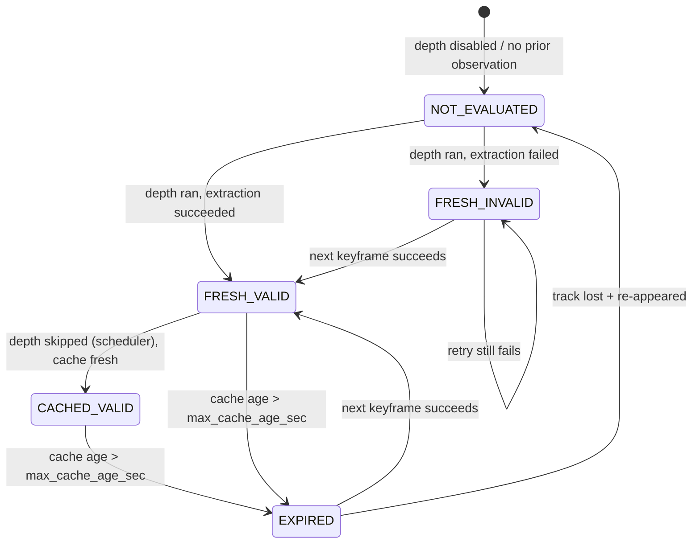
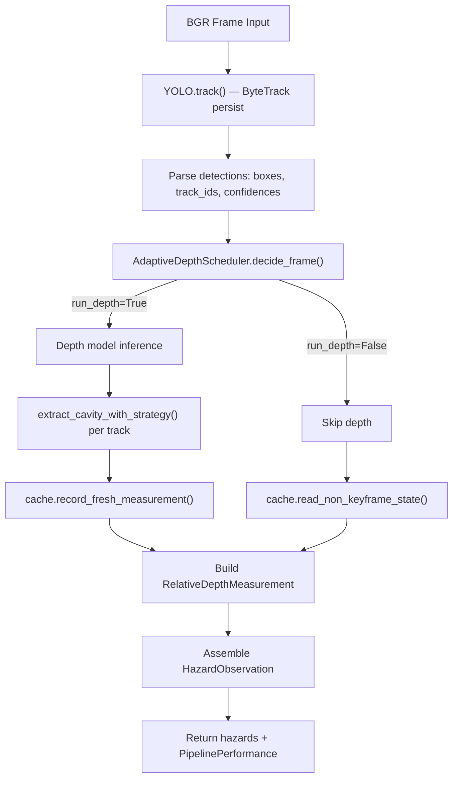

# Phase 8A — V2 Architecture Report

> [!NOTE]
> This report documents the RoadVision AI 2.0 prototype architecture. All evaluations are **exploratory**. No physical metric cm/mm values are computed or validated. Relative cavity scores are uncalibrated inverse-depth residuals.

---

## 1. Design Principles

| Principle | Implementation |
|-----------|---------------|
| **Physical metric isolation** | `MetricDepthCalibrator` is never instantiated in V2. All scores are labelled relative. |
| **Explicit null over fabricated zero** | Invalid / unavailable measurements are `None` in all schemas. |
| **Cache vs fresh distinction** | `CACHED_VALID` and `FRESH_VALID` are distinct states; EMA updates only on `FRESH_VALID`. |
| **Failure isolation** | Depth errors, GPU OOM, and extraction failures are caught per-frame; detection always continues. |
| **No production file modification** | V2 package is fully parallel to V1. |
| **Lazy experimental imports** | Adapters and extractors are imported lazily to prevent side effects at package import. |

---

## 2. Package Structure

```
roadvision_v2/
├── __init__.py          — Public exports
├── config.py            — Config loading + validation (8 nested dataclasses)
├── schemas.py           — Typed data contracts (8 dataclasses)
├── pipeline.py          — Main RoadVisionV2Pipeline class
├── perception/          — Subpackage stub (future: detector/depth adapters)
├── geometry/            — Subpackage stub (future: RANSAC/cavity wrappers)
├── scheduling/          — Subpackage stub (future: scheduler wrappers)
├── temporal/            — Subpackage stub (future: cache/EMA wrappers)
├── quality/             — Subpackage stub (future: quality gates)
└── telemetry/           — Subpackage stub (future: logging/CSV)

config/roadvision_v2.yaml — Unified 3-mode configuration file

run_roadvision_v2.py    — Standalone CLI entry point
```

---

## 3. Configuration System (`config.py`)

### 3.1 Nested Dataclasses

| Dataclass | Key Fields |
|-----------|-----------|
| `DetectorConfig` | model_id, checkpoint_path, tracker_config, input_size, conf_threshold, iou_threshold, horizon_cutoff_ratio |
| `DepthConfig` | enabled, model_id, input_size, precision, checkpoint_path |
| `RansacConfig` | sampling_mode, max_ref_samples, min/max_iters, batch_size, 11 quality gates |
| `CavityConfig` | strategy, reject_water_patches |
| `SchedulerConfig` | strategy, refresh_interval_sec, budget_target_ema_ms, starvation_override_sec, 12 fields |
| `CacheTemporalConfig` | max_cache_age_sec, tau_sec, rolling_window, fixed_alpha, 7 fields |
| `DiagnosticsConfig` | enable_horizon_proxy, visualize_annular, show_timing_hud |
| `RoadVisionV2Config` | mode, project_root + all above |

### 3.2 Validation Rules (all enforced in `validate()`)

- Mode must be in `("live", "balanced", "survey")`
- `detector.input_size` must be positive multiple of 32
- `depth_anything_v2_small` input_size must be divisible by 14
- `midas_small` requires `input_size=256` and rejects `fp16_weights`
- `ransac.min_iters <= max_iters` and both ≥ 1
- `cache_temporal.max_cache_age_sec > 0` and `tau_sec > 0`
- Scheduler expiry auto-synced to cache expiry at load time

### 3.3 Operating Modes

| Mode | Depth | Model | Precision | Scheduler | Cavity |
|------|-------|-------|-----------|-----------|--------|
| `live` | Disabled | midas_small | fp16_autocast | B_candidate_gated | full_box |
| `balanced` | Enabled | DAv2 Small | fp16_weights | E_budget_aware | elliptical_core |
| `survey` | Enabled | DAv2 Small | fp16_weights | B_candidate_gated | elliptical_core |

---

## 4. Data Schema (`schemas.py`)

### 4.1 Measurement State Machine



### 4.2 Score Nullification Rules (`__post_init__`)

| State | raw_score | norm_score | smoothed_score |
|-------|-----------|------------|----------------|
| `FRESH_VALID` | ✅ present | ✅ present | ✅ present |
| `FRESH_INVALID` | `None` | `None` | `None` |
| `CACHED_VALID` | `None` | `None` | ✅ preserved from last valid |
| `EXPIRED` | `None` | `None` | `None` |
| `NOT_EVALUATED` | `None` | `None` | `None` |

> [!IMPORTANT]
> `smoothed_relative_score` for `CACHED_VALID` is **preserved** (time-aware EMA from last valid keyframe). This is intentional: the EMA provides temporal continuity without fabricating a fresh observation.

### 4.3 HazardObservation Schema

```
HazardObservation
├── frame_context: FrameContext
│   └── session_id, frame_idx, timestamp_sec, frame_wh, mode, camera_profile, gps
├── detection: DetectionObservation
│   └── track_id, track_generation_id, box_xyxy, detector_confidence, class_id
├── measurement: RelativeDepthMeasurement
│   ├── raw_relative_cavity_score    ← iqr_norm_p75 (or None)
│   ├── normalized_relative_score   ← scale_norm_p75 (or None)
│   ├── smoothed_relative_score     ← time-aware EMA (or None)
│   ├── measurement_state           ← one of 5 explicit states
│   ├── measurement_validity        ← bool
│   ├── ref_diagnostics             ← RANSAC quality diagnostics
│   └── failure_reasons, warnings
└── horizon_diag: Optional[Dict]    ← research-only, never affects scores
```

---

## 5. Pipeline Architecture (`pipeline.py`)

### 5.1 Process-Frame Sequence



### 5.2 Depth Scheduler Strategies

| Strategy | V2 Mode | Behaviour |
|----------|---------|-----------|
| `A_always_on` | — | Depth every frame |
| `B_candidate_gated` | live, survey | Depth only when ≥1 track exists |
| `C_fixed_interval` | — | Depth every K frames |
| `D_track_aware` | — | Depth triggered by per-track causal criteria |
| `E_budget_aware` | balanced | D + latency budget ceiling with starvation protection |

### 5.3 Failure Isolation Contracts

| Failure Type | Behaviour |
|-------------|-----------|
| YOLO exception | Log + return `([], perf)` |
| Depth GPU OOM | `torch.cuda.empty_cache()` + return `None` depth, continue detection |
| Depth NaN/inf output | Log warning, skip per-frame depth |
| Extraction error | Log, record `FRESH_INVALID` with `extraction_error` reason |
| Scheduler error | Log, default to `run_depth=False` for frame |
| Missing GPS | `has_gps=False`, `gps_lat/lon=None`, no crash |
| Horizon tracker error | Log + `horizon_diag=None` (non-fatal) |

---

## 6. V2 Frozen Defaults (From Phase 7A Research)

| Parameter | Value | Source |
|-----------|-------|--------|
| `sampling_mode` | `stratified_quadrant` | Phase 7A optimal |
| `max_ref_samples` | 512 | Phase 7A optimal |
| `min_iters` | 16 | Phase 7A optimal |
| `max_iters` | 128 | Phase 7A optimal |
| `max_cache_age_sec` | 0.45 | Phase 7A optimal |
| `tau_sec` | 0.16 | Phase 7A optimal |
| `rolling_window` | 5 | Phase 7A optimal |
| `fixed_alpha` | 0.35 | Phase 7A optimal |
| `refresh_interval_sec` | 0.16 | Phase 7A optimal |
| `budget_target_ema_ms` | 38.0 | Phase 7A (25fps budget) |
| `budget_min_gap_sec` | 0.08 | Phase 7A optimal |

---

## 7. What V2 Does NOT Do

- ❌ Compute physical metric depth in cm/mm
- ❌ Report severity categories derived from relative scores
- ❌ Use `MetricDepthCalibrator` (`k_disp=0.082`, `depth_exponent=1.35`)
- ❌ Modify `roadvision_engine.py`, `server.py`, or any dashboard file
- ❌ Integrate YOLOv8n-seg into real-time processing
- ❌ Use MobileSAM in real-time mode
- ❌ Expose horizon proxy results as physically calibrated geometry

---

*Report generated: Phase 8A, RoadVision AI 2.0 Integration*
